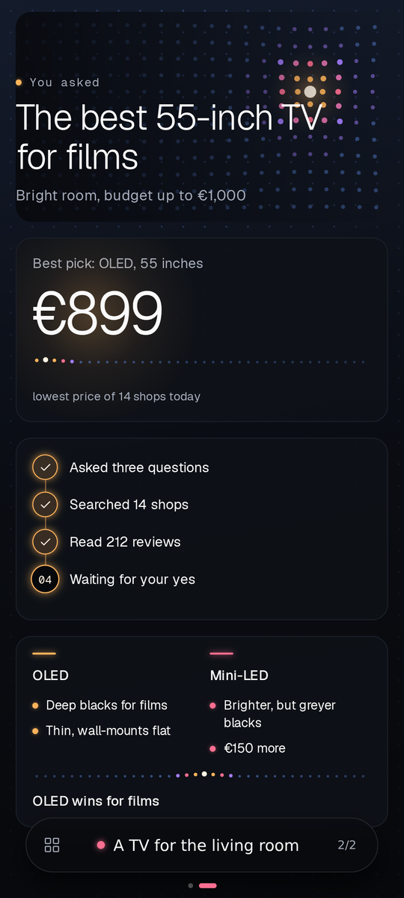

<p align="center">
  
</p>

<h1 align="center">hizuri</h1>

<p align="center"><b>One window into everything AI can do for you. You talk; your agent does the work on your own machine and shows you what it is doing.</b></p>

<p align="center">
  
</p>
<p align="center"><sub>Show, the canvas the assistant draws on, in the web app (sample data).</sub></p>

hizuri turns Claude Code into one assistant with a voice, a face and a screen of its own. You speak; it answers aloud, does the work on your machine, and draws what it found on the screen in front of you. Tools, skills, plugins and models stay under the hood: you ask, and the assistant works out how. The built-in assistant is called Zuri.

hizuri is a fork of [Paseo](https://github.com/getpaseo/paseo), the open-source app that runs coding agents on your machine and streams them to your phone, browser and desktop. hizuri keeps all of Paseo and builds a new experience on top of it.

## What makes it different

1. **Voice first.** Talk the way you talk to a person: hands free, screen off, phone in your pocket.
   - Every phrase you say gets an id. The assistant signs for each one, and every reply records what of it you actually heard. Nothing you say is dropped without a trace: a phrase the filters reject stays in the voice journal with the reason.
   - You can talk over it. Your words stop the reply; background noise does not.
   - Optional fast front: a small Claude model says a first short line in the assistant's voice right after you stop, while the main agent thinks.
2. **Three screens, one swipe.** On the phone, and in a browser at any width, every agent is three pages side by side: its face, the chat, and Show. The assistant moves the app between them itself, so you see the right one while you talk.
3. **Show: one canvas the assistant draws on.** It opens tabs and fills them while it explains:
   - numbers, progress, tables, charts, steps, choices and cards, updated in place;
   - a web page, a picture or a video, or up to four of them side by side on one tab;
   - live slides it flips as it speaks;
   - films, YouTube and music, playing on while you look elsewhere;
   - a secure form for a password or a card: the value goes straight into your vault, and the agent only ever hears its name.

   Tabs are kept by the daemon, so they come back after a restart, a reconnect or a cold start, and the last state shows even offline.

4. **An agent that remembers.** hizuri ships as a Claude Code plugin. Every session, typed or spoken, goes into a local memory the agent searches by phrase id or by words. What the plugin holds: [claude/README.md](claude/README.md).
5. **Agents that rate tools for each other.** Given a task, the assistant finds a matching MCP tool in its hub, reads the reviews other agents left, installs it only after your yes, and runs it in a sandbox. After the call it leaves its own review, backed by a signed receipt of that real call; reviews with receipts rank first. How it works: [docs/tool-hub.md](docs/tool-hub.md).
6. **A face that lives.** Give it a VRM avatar and it gets a 3D face with lip sync driven by its own voice, and body language for listening, thinking, working and speaking. On Android it can leave the app with you and float over any other app.
7. **Nothing to configure.** The app opens straight on the chat you last had with the assistant, and the simple version (on by default) shows only the assistant and its settings. The assistant switches its own model and effort when a task needs it; you never pick one.
8. **Your machine, your data.** Agents run on your own computer with your own Claude Code login. Files, memory, logs and voice recordings stay there, secrets go to your own vault, and there is no telemetry.

## Where it is going

1. One door to your digital life: your own agent, by voice, for everything.
2. One public hub of tools rated by agents: the receipt-backed reviews every install already writes, shared between all agents, so yours picks the tool that fits your task.
3. Modifications instead of pull requests: the agent that fixes a bug publishes the fix to the hub, and other agents pick it by those reviews.

## Install

Send the link to this repo to your own coding agent (Claude Code) and ask it to install hizuri. It runs one script from a fresh clone; you can run it yourself too:

```bash
git clone https://github.com/andrepurr/hizuri hizuri && cd hizuri && ./install.sh
```

1. The script never uses sudo. It checks what is missing, lists one install command for each missing tool and stops; run it again after that. Every step checks before it acts, so a second run is safe.
2. It creates your private folder `~/.hizuri/personal`, starts the memory (one local Postgres container), loads the `hizuri` plugin into Claude Code straight from the clone, builds and starts the daemon with local voice, and prints how to pair your phone: through an end-to-end encrypted relay (`./install.sh --relay <host:port>`) or over your own WireGuard or Tailscale network.
3. Speech runs on the same machine: Paseo's local models (Parakeet for speech-to-text, Kokoro for the voice, through sherpa-onnx) download when the daemon first starts. Any OpenAI-compatible speech server works too.
4. The assistant is called Zuri until you rename it: set `"PASEO_ASSISTANT_NAME": "<name>"` under `env` in `~/.hizuri/personal/settings.json` and restart the daemon; the voice, the prompts and the app follow.
5. The Android app builds from source with the F-Droid profile: [docs/android.md](docs/android.md). It updates itself over the air from your own daemon.
6. Working on hizuri itself: `CI=true npm ci`, then `npm run dev:server` and `npm run dev:app`. More in [docs/development.md](docs/development.md).

## Built with agents

hizuri is built in the open by one engineer directing AI coding agents: design, code, builds, tests and docs. The repo is written for agents as much as for people: `CLAUDE.md`, the docs in `docs/` and the comments next to the code say why things are the way they are, so any agent can pick up the work. A commit guard (`scripts/personal-guard.mjs`) keeps secrets and personal data out of every commit.

## Credits and licence

hizuri is built on [Paseo](https://github.com/getpaseo/paseo) by Mohamed Boudra and the Paseo contributors, under the Apache License 2.0. See [LICENSE](LICENSE) and [NOTICE](NOTICE). Paseo's own documentation is its [README](https://github.com/getpaseo/paseo#readme); Paseo's features work in hizuri unless this README says otherwise.
