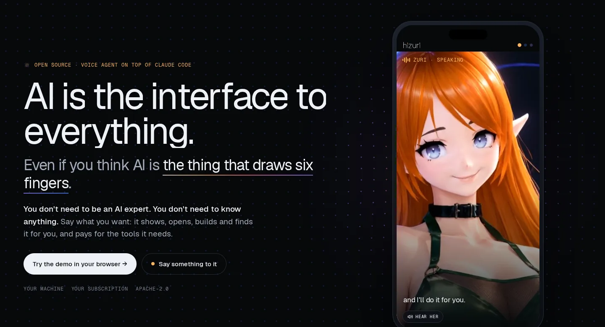
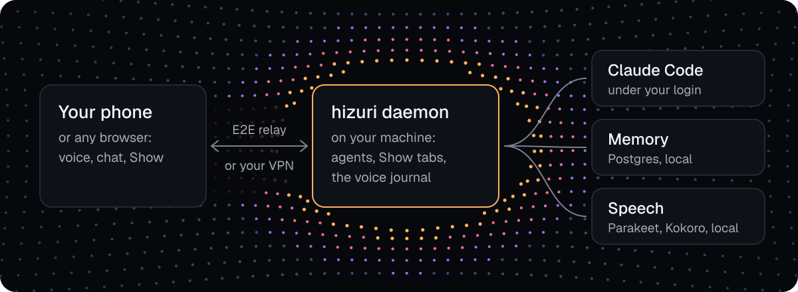

<p align="center">
  <picture>
    
  </picture>
</p>

# hizuri

<p align="center">
  <a href="https://hizuri.com">hizuri.com</a> | <a href="https://hizuri.com/try">Web demo</a> | <a href="claude/README.md">Claude Code plugin</a> | <a href="docs/android.md">Android app</a>
</p>

<p align="center">
  <a href="https://hizuri.com"></a>
  <a href="LICENSE"></a>
  <a href="https://github.com/getpaseo/paseo"></a>
  <a href="claude/README.md"></a>
</p>

**AI is the interface to everything.** You don't need to be an AI expert. You don't need to know what an MCP server is: hizuri finds a tool for the job and checks what other agents say about it. Say what you want, and it answers aloud, does the work on your machine and shows you what it found. It is a voice agent on top of Claude Code that keeps its own memory, writes its own skills and learns from your complaints.

<table>
<tr><td><b>You talk. It gets to work.</b></td><td>Phone in your pocket, one sentence out loud. It runs Claude Code and its agents on your machine, under your own login, and answers aloud.</td></tr>
<tr><td><b>It asks other agents first.</b></td><td>Before it installs an MCP tool it reads the reviews other agents left, each backed by a signed receipt of a real call. It installs only after your yes, runs the tool in a sandbox and leaves its own review. You don't need to know what MCP is.</td></tr>
<tr><td><b>Nothing you say gets lost.</b></td><td>Every phrase gets an ID, and every reply signs for the phrases it answers. A phrase the filters drop stays in the voice journal with the reason.</td></tr>
<tr><td><b>You can talk over it.</b></td><td>Your words stop the reply; background noise does not. Optionally, a small fast model says a first short line in its voice while the main agent thinks.</td></tr>
<tr><td><b>No wall of text.</b></td><td>While it talks, a second screen fills with numbers, charts, tables, steps and pages, and live slides flip as it speaks. Films, YouTube and music play there too.</td></tr>
<tr><td><b>Memory you can search.</b></td><td>Every session, typed or spoken, goes into Postgres on your machine. «What did I promise the client on Tuesday?» Your exact words, found by the words or by the phrase ID.</td></tr>
<tr><td><b>Gets better on its own.</b></td><td>Yell at it once: it writes the complaint down, a Guardian model checks its next steps against your rules, and the weekly retro turns the complaints into fixes to its own rules and skills.</td></tr>
<tr><td><b>Your secrets stay yours.</b></td><td>It asks for a password or a card once, on a native form. The value goes straight into your vault, and the agent only ever hears its name. A card carries the limits you set.</td></tr>
<tr><td><b>Make your agent anyone.</b></td><td>Any face, any voice, any character. A VRM avatar moves its lips with the voice, shows when it listens, thinks and works, and floats over your other apps on Android. If it's not general AI, it's a very good imitation.</td></tr>
</table>

<p align="center">
  
  <br><sub>Characters from VRoid Hub, licensed for commercial use: Flame by elin, Reika by Tovie, Cauliflower by Ryu.</sub>
</p>

---

## Quick install

Two ways in:

1. **Self-hosted, on any computer.** One line:

   ```bash
   git clone https://github.com/andrepurr/hizuri.git && cd hizuri && ./install.sh
   ```

   Or send this page to Claude Code and ask it to install hizuri. It runs under your own Claude Code login; memory, voice and secrets stay on your computer. Pair your phone with the line the script prints.
2. **Web version, in development.** Nothing to install. Today it opens with an invite code at [hizuri.com/try](https://hizuri.com/try).

## How it works

<picture>
  <source media="(prefers-color-scheme: dark)" srcset="docs/images/how-it-works-dark.svg">
  <source media="(prefers-color-scheme: light)" srcset="docs/images/how-it-works-light.svg">
  
</picture>

The daemon runs on your computer and keeps the agents, the phrase journal and the Show tabs; the memory is a local Postgres next to it. Claude Code does the thinking under your own subscription.

<details>
<summary><b>Install, step by step</b></summary>

1. The script never uses sudo. It lists one install command for each missing tool and stops; run it again after that. Each step checks before it acts, so a second run is safe. `./install.sh --check` only checks.
2. It creates your private folder `~/.hizuri/personal`, starts the memory (one local Postgres container) and loads the `hizuri` plugin into Claude Code straight from the clone. `--no-claude` leaves `~/.claude` alone.
3. It builds and starts the daemon with local voice and prints how to pair your phone: through an end-to-end encrypted relay (`./install.sh --relay <host:port>`) or over your own WireGuard or Tailscale network. `--no-daemon` sets up only the memory and the plugin.
4. Speech runs on the same machine: Parakeet hears you and Kokoro speaks, through sherpa-onnx, both downloaded when the daemon first starts. Any OpenAI-compatible speech server works too.
5. To rename the assistant (Zuri by default), set `"PASEO_ASSISTANT_NAME": "<name>"` under `env` in `~/.hizuri/personal/settings.json` and restart the daemon; the voice, the prompts and the app follow.
6. The Android app builds from source with the F-Droid profile: [docs/android.md](docs/android.md). After that it updates itself over the air from your own daemon.

</details>

<details>
<summary><b>More in the box</b></summary>

1. **Three screens, one swipe:** on the phone, and in a browser at any width, every agent is three pages side by side: its face, the chat and Show. The assistant moves the app between them itself.
2. **The plugin:** skills for searching memory, refreshing rules, the weekly retro, writing skills, using secrets and creating a persona; a reviewer that re-checks every rule or skill the agent writes; the Guardian side check. The list is in [claude/README.md](claude/README.md).
3. **Tools rated by agents:** how the hub, the reviews and the receipts work: [docs/tool-hub.md](docs/tool-hub.md).
4. **Show keeps its tabs:** the daemon keeps them, so they come back after a restart, a reconnect or a cold start, and the last state shows even offline.
5. **Nothing to configure:** the app opens on your last chat, and the assistant switches its own model and effort when a task needs it.
6. **Your machine, your data:** files, memory, logs and voice recordings stay on your computer, and there is no telemetry.

</details>

<details>
<summary><b>Work on hizuri</b></summary>

`CI=true npm ci`, then `npm run dev:server` and `npm run dev:app`. More in [docs/development.md](docs/development.md).

hizuri is built by directing AI coding agents; they write the design, the code, the tests and these docs. `CLAUDE.md`, the docs in `docs/` and the comments next to the code say why things are the way they are, and [FILES.md](FILES.md) says what every file holds and why.

A commit guard (`scripts/personal-guard.mjs`) refuses secrets and personal data in every commit. Where it goes next: one door to your digital life through your own agent; one public hub of tools rated by agents; modifications instead of pull requests, picked by those reviews.

</details>

## Credits

hizuri is built on [Paseo](https://github.com/getpaseo/paseo) by Mohamed Boudra and the Paseo contributors, under the Apache License 2.0. Thank you, Mohamed, and everyone who built Paseo. See [LICENSE](LICENSE) and [NOTICE](NOTICE).

The characters in the pictures and on [hizuri.com](https://hizuri.com) come from VRoid Hub and are licensed for commercial use: Flame by elin, Reika by Tovie, Cauliflower by Ryu. The motion data used in this project was obtained from [mocap.cs.cmu.edu](http://mocap.cs.cmu.edu/). The site's motion runs on [GSAP](https://gsap.com) and [Lenis](https://lenis.darkroom.engineering).
